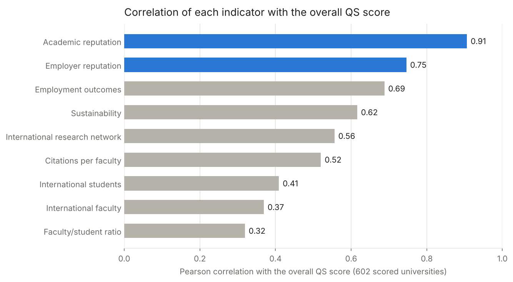
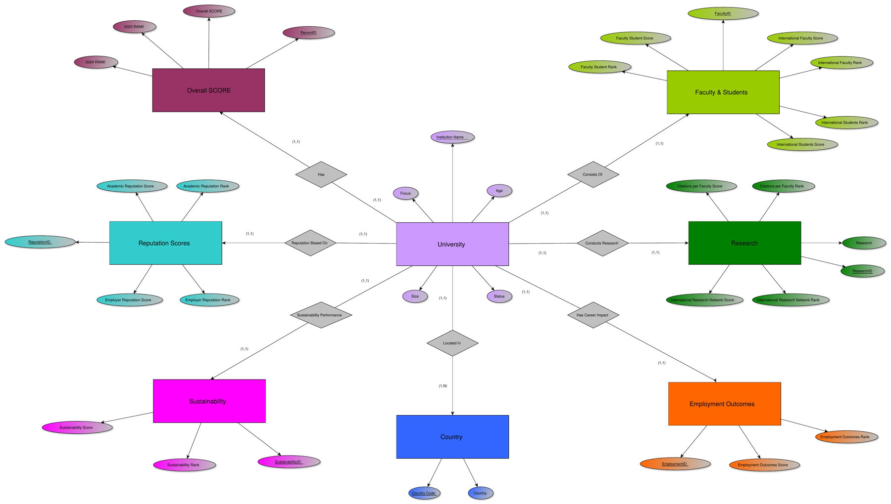
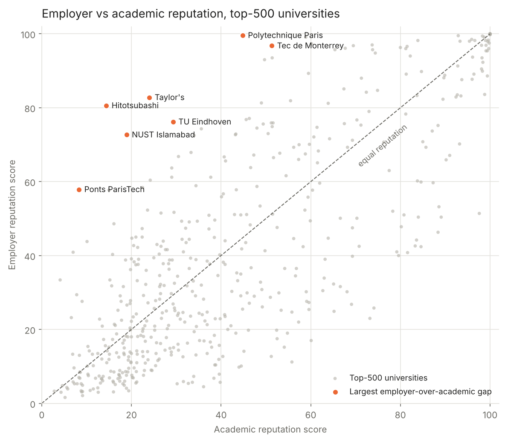
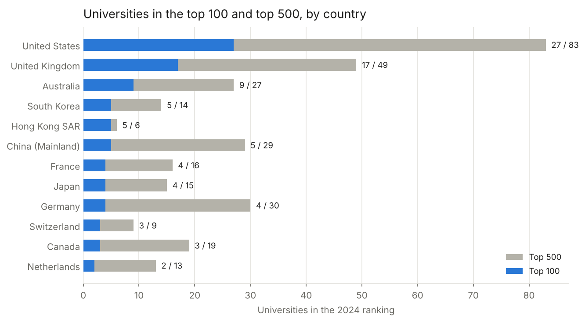

# Relational Modelling and SQL Analytics of the QS World University Rankings

**Research question:** Which of the nine QS indicators move with a university's overall position, and where do academic and employer views of a university diverge?

**Completed:** December 2024, revised November 2026 · **Data:** QS World University Rankings 2024, 1,497 universities in 104 countries · **Methods:** relational modelling, SQL (CTEs, window functions, in-database correlation), Python loading pipeline, unit tests



> **Key findings**
> - **Reputation surveys dominate.** Academic reputation correlates **0.91** with the overall score. Citations per faculty, also heavily weighted, correlates only **0.52**.
> - **Employers and academics disagree in predictable places.** The largest employer-over-academic gaps in the top 500 are technical and business-oriented institutions: Hitotsubashi (+66 points), Polytechnique Paris, TU Eindhoven, Tec de Monterrey.
> - **The top is concentrated.** The United States and the United Kingdom hold **44 of the top 100**.
> - **Data handling changes the answer.** Treating missing scores as zero, as the first version of this project did, cuts the average overall score from **40.9 to 16.4**.

**Stack:** SQL (SQLite) · Python · pandas · matplotlib · pytest

---

## Data model

Eight tables: `Country` and `University`, plus one table per indicator family (rankings, research, reputation, employment outcomes, sustainability, faculty and students), each one-to-one with `University`. Constraints enforce valid codes and score ranges, and foreign keys are checked on load.



QS publishes exact ranks and an overall score only for the top ~600; the rest are placed in bands (`601-610`, `1401+`). Each rank is stored as its published label plus a numeric `rank_min` / `rank_max`, so bands stay sortable, and missing scores stay `NULL`.

## Analyses

All queries are in [`sql/queries.sql`](sql/queries.sql) and run by name from the notebook.

| Query | SQL features | Question |
|---|---|---|
| `indicator_correlation` | CTE, `UNION ALL`, aggregate Pearson formula | Which indicators move with the overall score? |
| `employability_gap` | multi-table join, computed ranking | Which universities do employers rate far above academics? |
| `best_by_country` | `RANK() OVER (PARTITION BY …)`, `COUNT() OVER` | Who leads each national system? |
| `country_concentration` | conditional aggregation, `HAVING` | Where are the top 100 and top 500? |
| `employment_by_country` | `GROUP BY` with minimum-size filter | Which systems produce the best employment outcomes? |
| `biggest_movers` | filtering on parsed rank bands | Who moved most between 2023 and 2024? |
| `zero_fill_bias` | `COALESCE` | How much does zero-filling distort the averages? |

## Results

**Employer vs academic reputation.** Most universities sit near the diagonal; the outliers are institutions that recruiters value far more than academics do.



**Concentration by country.**



| Country | Universities (≥ 20) | Avg employment outcomes | Avg employer reputation |
|---|---:|---:|---:|
| Canada | 31 | 32.8 | 27.7 |
| United States | 199 | 28.0 | 21.6 |
| Australia | 38 | 25.4 | 27.6 |
| United Kingdom | 90 | 22.0 | 29.6 |

## What changed from the first version

| | Original (December 2024) | This revision |
|---|---|---|
| Database | MySQL server required | SQLite, runs with no installation |
| Credentials | Password typed in plain text at a prompt | None needed |
| Missing values | Replaced with 0, including band ranks such as `601-610` | Kept as `NULL`; bands parsed into min/max |
| Indicator tables | Auto-increment IDs, duplicated rows on every reload (hence `DISTINCT` in queries) | One row per university, keyed by `university_id` |
| Column names | `2023_Rank` (not valid standard SQL) | `rank_2023_min`, `rank_2023_label` |
| "Correlation" query | Listed 25 rows, no correlation computed | Pearson r computed in SQL for every indicator |
| Country averages | Included countries with one university | Minimum of 20 universities per country |
| Tests | None | 12 tests: rank parsing, row counts, foreign keys, NULL handling, queries |

## Limitations

- One edition of one ranking. Correlations with indicators are partly mechanical, because the overall score is their weighted sum.
- Band-ranked universities have no overall score, so the correlation analysis covers the top 602 only.
- Reputation scores come from QS surveys, and the sample of respondents is not public.

## Reproducibility

```bash
pip install -r requirements.txt
python -m src.load          # builds qs_rankings.db from the CSV (under a second)
pytest                      # 12 tests
jupyter notebook analysis.ipynb
```

```
├── sql/
│   ├── schema.sql        tables, keys and constraints
│   └── queries.sql       named analytical queries
├── src/
│   ├── load.py           cleaning, rank parsing, loading, query runner
│   └── plots.py          charts
├── tests/                pytest suite
├── data/                 QS 2024 dataset (CSV)
├── docs/                 original ER diagram (PDF)
├── images/               figures used in this README
└── analysis.ipynb        full analysis with outputs
```

---

<sub>Francesca D'Aloia Cascone. Revised from a group project for the Databases and Big Data course at LUISS Guido Carli (December 2024).</sub>
